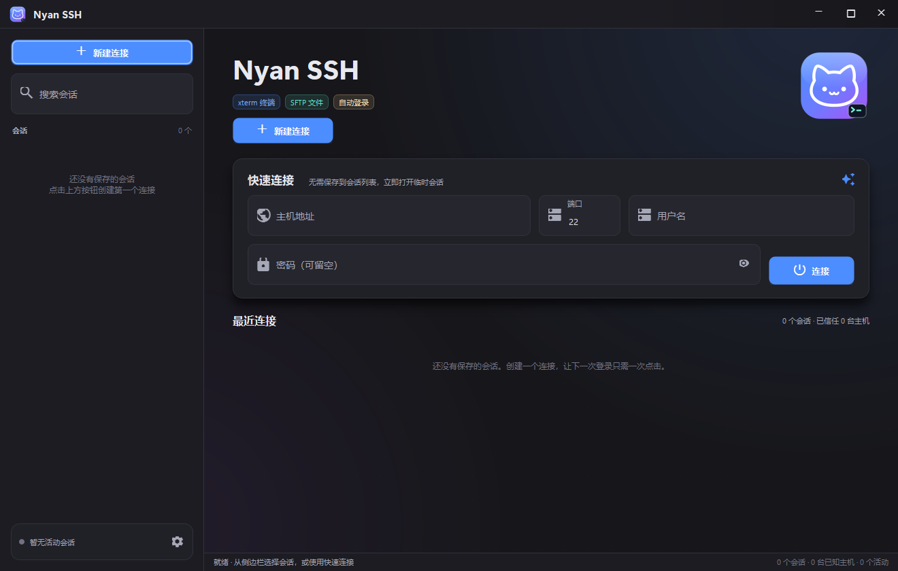
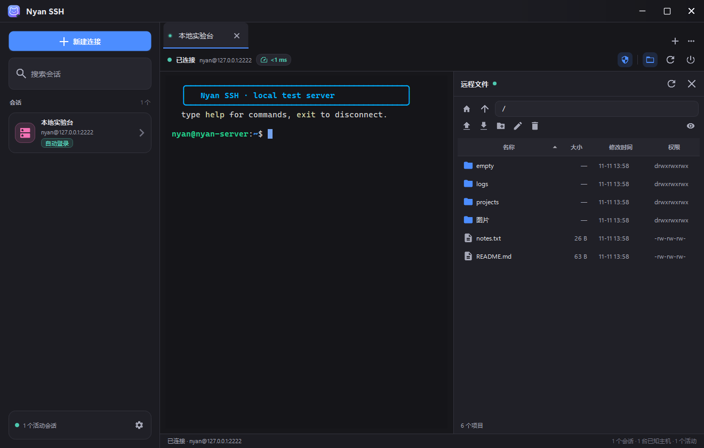
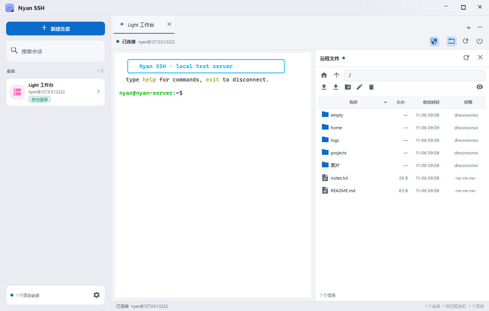
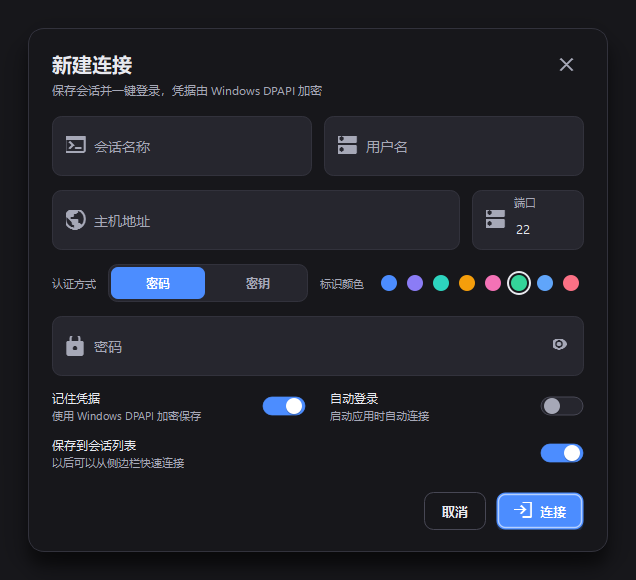
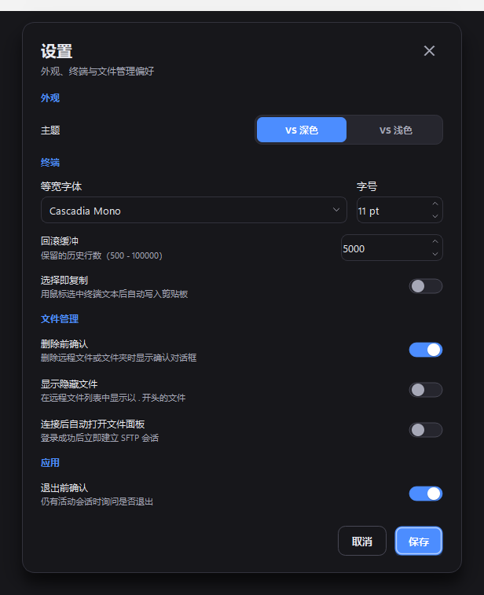
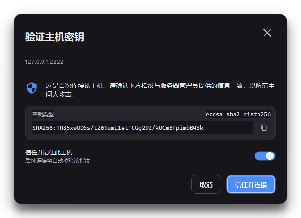
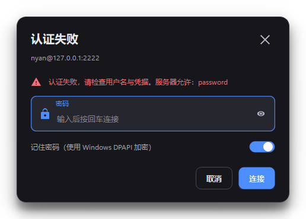

# Nyan SSH


> Material 风格 + VS2026 配色的 Windows SSH 客户端。

基于 **CMake + Qt 6.12 + C++20** 构建，libssh2 通过 `FetchContent` 固定版本拉取，SSH 加密层使用 **OpenSSL**，支持交互式终端、SFTP 远端文件管理、会话记忆、Windows DPAPI 凭据加密与自动登录。



## 功能

### 终端
- xterm-256color 伪终端，支持 16 色 / 256 色 / 24 位真彩色 ANSI SGR。
- 自研 VT100/xterm 屏幕缓冲：光标定位、擦除、滚动区域、备用屏幕（vim/tmux）、宽字符与中文、标题（OSC 0/2）、窗口尺寸变更。
- 可回滚历史（默认 5000 行），鼠标滚轮回看、选区复制、右键菜单、字号缩放。
- 输入映射完整：方向键 / Home / End / PgUp / PgDn / F1–F12、Ctrl 组合键、Alt 前缀、括号粘贴、中文输入法提交。
- 关键序列：`Ctrl+Shift+C` 复制、`Ctrl+Shift+V` / `Shift+Insert` 粘贴、`Ctrl + 加号/减号/0` 缩放。

### 会话与安全
- 保存任意数量的连接配置，侧边栏搜索、最近使用排序。
- 密码和私钥口令使用 **Windows DPAPI**（当前用户绑定）加密后写入 `sessions.json`，绝不明文落盘。
- **记住登录信息 / 自动登录**：启动时自动连接所有勾选自动登录且凭据完整的会话。
- **会话延迟显示**：连接成功后每 5 秒探测一次到主机的 TCP 往返延迟，工具栏按延迟分级着色。
- 支持密码与 **公钥认证**（libssh2 + OpenSSL，读取 PEM 格式 RSA / ECDSA / Ed25519 私钥，可选口令）。
- **主机密钥 TOFU 校验**：首次连接弹出指纹确认，后续连接自动比对；密钥变化时显示红色告警，防止中间人攻击。
- 认证失败时弹出密码/口令重试对话框，可选择把新凭据加密保存。

### 远端文件管理
- 独立 SFTP 连接（不阻塞终端），目录浏览、面包屑式路径编辑、上级目录 / 主目录跳转。
- 表格排序、隐藏文件开关、文件类型图标、权限与修改时间展示。
- 上传 / 下载队列，实时进度与取消；上传支持多选和拖放。
- 新建文件夹、重命名、批量删除（文件夹递归删除二次确认）、复制远端路径。
- 双击文件夹进入，双击文件下载到本地并用默认程序打开。

### 界面
- **无边框窗口 + 自绘标题栏**：支持拖动、双击最大化/还原、四边与四角缩放、最小化/最大化/关闭、任务栏集成。
- 应用图标以极简猫咪脸为原型：白色猫脸 + `>_` 终端徽标，蓝紫渐变圆角底，提供 16–256px 多尺寸 ICO。
- Material 3 风格的悬浮标签输入框、状态层按钮、涟漪、开关、分段控件、卡片、Snackbar、无边框对话框。
- **Material Icons** 图标字体统一按钮、输入框、文件列表与标题栏图标；专用图形保留 SVG 回退。
- **VS 深色 / VS 浅色** 两套主题，参考 Visual Studio 2026 / VS Code 的配色与终端 ANSI 色板。
- **Segoe UI Variable** 界面字体 + **Cascadia Mono** 终端字体，高 DPI 缩放，深浅主题即时切换。

## 截图

| 深色会话 + SFTP | 浅色会话 |
| --- | --- |
|  |  |

| 新建连接 | 设置 |
| --- | --- |
|  |  |

| 主机密钥验证 | 认证失败重试 |
| --- | --- |
|  |  |

## 构建

### 环境要求

- Windows 10/11 x64。
- Visual Studio 2022 或 2026，安装“使用 C++ 的桌面开发”（MSVC v143/v145）。
- CMake ≥ 3.28（VS 自带版本即可）。
- Qt **6.12.0** 为首选版本，套件 `msvc2022_64`，需要 `Widgets`、`Svg`、`Network`、`Test` 模块。
  默认自动探测 `D:\Qt\6.12.0\msvc2022_64` 或 `C:\Qt\6.12.0\msvc2022_64`；可通过 `-DQT_ROOT=...` 指定。
  GitHub Release 目前使用公共 aqt 仓库最新可用的 **Qt 6.10.3**，构建时传入 `-AllowQt610` / `-DNYAN_ALLOW_QT_610=ON`；本地默认仍要求 Qt 6.12。
- **OpenSSL 3.0+** 开发库。Windows 推荐：
  ```powershell
  vcpkg install openssl:x64-windows
  $env:OPENSSL_ROOT_DIR = 'E:\Tools\vcpkg\installed\x64-windows'
  ```
  Linux/macOS 安装系统 `libssl-dev` / `openssl@3` 即可。
- 首次配置需要联网下载 libssh2 1.11.1（CMake `FetchContent`，带 SHA256 校验）。离线构建可指定已解压源码：
  `-DFETCHCONTENT_SOURCE_DIR_LIBSSH2=<path-to-libssh2>`。
- Python 3 + `paramiko`（仅运行本地测试服务器时需要）。

### 一键构建（推荐）

```powershell
# Debug
.\scripts\build.ps1 -OpenSslRoot $env:OPENSSL_ROOT_DIR

# Release，并执行 windeployqt
.\scripts\build.ps1 -Configuration Release -Clean -OpenSslRoot $env:OPENSSL_ROOT_DIR
```

如果已把 OpenSSL 安装到 CMake 的默认搜索路径，可省略 `-OpenSslRoot` / `-DOPENSSL_ROOT_DIR`。

脚本会自动定位最新 Visual Studio 的 `vcvars64.bat`，配置 CMake + Ninja，编译、部署 Qt 运行时，最后运行单元测试。
产物：`build\Release\NyanSSH.exe`（连同 Qt DLL 与插件，可直接运行）。

### 手动构建

在 **Visual Studio Developer PowerShell** 中：

```powershell
cmake -S . -B build -G Ninja `
  -DCMAKE_BUILD_TYPE=Release `
  -DCMAKE_PREFIX_PATH=D:\Qt\6.12.0\msvc2022_64 `
  -DOPENSSL_ROOT_DIR=E:\Tools\vcpkg\installed\x64-windows
cmake --build build --parallel
D:\Qt\6.12.0\msvc2022_64\bin\windeployqt.exe --no-translations build\NyanSSH.exe
```

也可以使用 CMake Presets：

```powershell
cmake --preset release
cmake --build --preset release
```

### 打包 ZIP

```powershell
.\scripts\package.ps1 -Configuration Release -OpenSslRoot $env:OPENSSL_ROOT_DIR
```

执行 `cmake --install`（内含 Qt 部署脚本）并输出 `dist\NyanSSH-0.1.0-win64.zip`。

## 自动发布

仓库包含 tag 触发的 GitHub Actions 发布流程：
[`.github/workflows/release.yml`](.github/workflows/release.yml)。

发布步骤：

1. 更新 `CMakeLists.txt` 中的 `project(NyanSSH VERSION ...)`，并提交到 `master`。
2. 创建并推送标签：
   ```powershell
   git tag -a v0.1.1 -m "Nyan SSH v0.1.1"
   git push origin v0.1.1
   ```
3. Actions 会自动安装 Qt/OpenSSL，构建并执行单元与 SSH/SFTP 集成测试，然后生成 ZIP、SHA-256 校验文件和 Release。

发布页会包含：标签/版本/提交、上一版本对比、本次提交列表、构建环境、下载文件与 SHA-256、安装步骤和已知限制。标签版本必须与 `CMakeLists.txt` 中的工程版本一致（预发布标签如 `v0.1.1-beta.1` 匹配基础版本 `0.1.1`）。
工作流添加前已经存在的 tag 不会回溯触发发布。

## 运行与数据

默认数据目录：`%APPDATA%\NyanSSH\`

| 文件 | 内容 |
| --- | --- |
| `sessions.json` | 会话列表；密码/口令为 DPAPI 密文 |
| `known_hosts.json` | TOFU 主机密钥指纹 |
| `settings.ini` | 主题、终端字体、字号、行为设置 |

设置环境变量 `NYAN_SSH_HOME` 可把全部状态重定向到其他目录（测试/便携模式）：

```powershell
$env:NYAN_SSH_HOME = "$PWD\.testdata\demo"
```

### 命令行

```powershell
# 直接打开某个会话
NyanSSH.exe --connect nyan@127.0.0.1:2222 --password nyan123

# 使用私钥（PEM 格式）
NyanSSH.exe --connect nyan@example.com --key $HOME\.ssh\id_rsa
```

> OpenSSH 新版 `BEGIN OPENSSH PRIVATE KEY` 私钥需先转换为 PEM：
> `ssh-keygen -p -m PEM -f id_rsa`。

支持的位置参数 `user@host[:port]` 与 `--connect` 等价。凭据不会写入磁盘（除非在登录界面勾选“记住凭据”）。

## 快捷键

| 快捷键 | 功能 |
| --- | --- |
| `Ctrl+N` | 新建连接 |
| `Ctrl+,` | 设置 |
| `Ctrl+W` | 关闭当前标签页 |
| `Ctrl+Tab` / `Ctrl+Shift+Tab` | 切换标签页 |
| `Ctrl+Shift+F` | 打开/关闭远端文件面板 |
| `Ctrl+Shift+C` / `Ctrl+Insert` | 复制终端选区 |
| `Ctrl+Shift+V` / `Shift+Insert` | 粘贴到终端 |
| `Ctrl + +` / `Ctrl + -` / `Ctrl + 0` | 放大 / 缩小 / 重置终端字号 |

## 测试

项目自带一个基于 paramiko 的本地 SSH/SFTP 服务器与多层测试。

```powershell
# 安装测试依赖
python -m pip install paramiko

# 构建 + 启动服务器 + 运行全部自动化测试
.\scripts\test.ps1 -Configuration Debug
```

测试内容：

| 目标 | 覆盖 |
| --- | --- |
| `nyan_tests` | DPAPI、会话 JSON、主机密钥存储、远程路径、ANSI 解析/滚动/宽字符/备用屏幕 |
| `nyan_smoke` | libssh2 密码认证、PTY shell、SFTP 列表/下载/上传（密码与公钥两种认证） |
| `nyan_ssh_worker_test` | 主机密钥交互回调、认证、Shell 读写、线程退出 |
| `nyan_sftp_worker_test` | SFTP 建目录、上传、下载、重命名、递归删除 |
| `nyan_ui_integration` | 真实 `FilePanel` + `SftpWorker`：目录双击跳转、上传后刷新列表 |

也可以手动启动测试服务器：

```powershell
.\scripts\dev-server.ps1
# 127.0.0.1:2222  nyan / nyan123
# 客户端密钥 tests/server/client_rsa.key
```

## 目录结构

```text
CMakeLists.txt
src/
  main.cpp
  core/        配置、DPAPI、会话/主机密钥存储、SSH/SFTP worker、libssh2 封装
  term/        VT 屏幕缓冲、ANSI 解析器、终端渲染与输入
  ui/          主题、Material 控件、主窗口、会话页、文件面板、对话框
resources/     图标、Material Icons 字体、Logo、Windows 版本资源
tests/         单元测试、后端/UI 集成测试、paramiko 测试服务器
licenses/      Qt、libssh2、OpenSSL、Material Icons 许可证文本
scripts/       构建、测试、开发服务器、打包
docs/          截图与设计产物
```

线程模型：每个交互会话拥有一个 `SshWorker` 线程；SFTP 使用独立的 SSH 会话与 `SftpWorker` 线程，因此传输大文件时终端输入/输出不受影响。UI 与 worker 之间只通过线程安全队列和 Qt 信号交互。

## 已知限制

- 文件上传当前仅支持文件，不支持递归上传本地文件夹。
- SFTP 传输队列同一时间只执行一个任务（可排队、可取消）。
- 未实现端口转发、X11、SSH agent 转发和终端鼠标上报（vim/htop 可用键盘操作）。
- 使用 libssh2 的 **OpenSSL** 加密后端：支持 RSA / ECDSA / Ed25519 密钥与主机密钥。
- 私钥仅支持 PEM 格式；OpenSSH 新格式需先转为 PEM。认证方式为密码或公钥；不支持 keyboard-interactive / OTP 多因素认证。
- 终端使用 Unicode 宽度近似算法，极端 emoji/组合字符可能与系统终端略有差异。
- 当前应用仍仅支持 Windows：SSH 加密层已经使用可移植的 OpenSSL，但凭据存储仍依赖 DPAPI，窗口标题栏和打包脚本仍含 Win32/Windows 逻辑。要完整跨平台还需替换这些平台层。
- 会话延迟为到主机的 TCP 连接往返近似值（每 5 秒一次），不是 SSH 协议内的 keepalive RTT；主机禁连或端口不可达时会显示 “—”。
- 等宽字体下拉框通过 `QFontDatabase::isFixedPitch()` 精确筛选；若系统字体未正确报告该属性，个别字体可能不会出现。

## 许可

本项目代码使用 MIT License（见 `LICENSE`）。
libssh2（通过 FetchContent 拉取的 1.11.1）为 BSD 3-Clause；OpenSSL 为 Apache-2.0；Qt 以 LGPL-3.0 动态链接方式使用；Material Icons 字体以 Apache-2.0 使用。详见 `THIRD_PARTY_NOTICES.md`。
